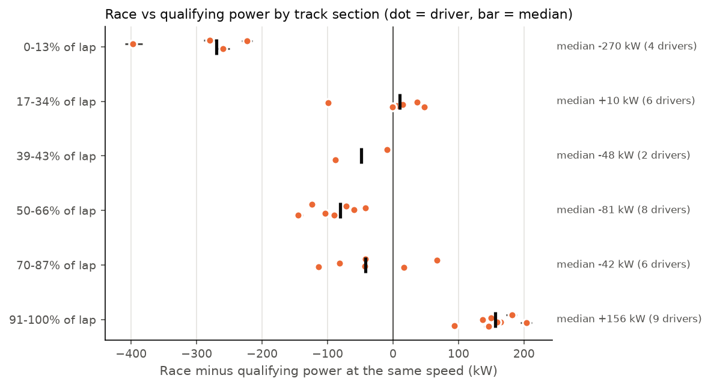
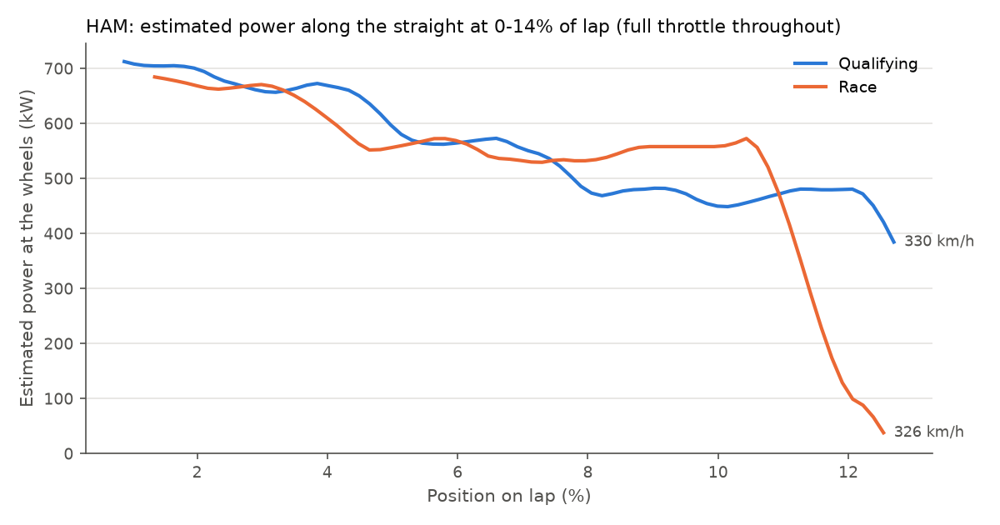
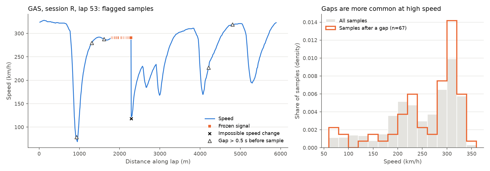

# 2026 F1 Energy Deployment Analysis

> **Status:** core analysis complete (data loading, data quality checks, physics model, race vs qualifying comparison, 20 tests). **Next:** a smoothing sensitivity check and the final write-up.

## Question

Under the 2026 Formula 1 regulations, roughly half of the car's power comes from the electric motor, but the battery is small. **Where on a lap do cars run short of electrical energy, and how does that differ between qualifying and the race?**

There is no public battery data, so this project infers it: it estimates the power each car is producing from public speed telemetry using a simple physics model, with the data validated first and the uncertainty quantified.

## Key findings so far

*2026 Italian Grand Prix (Monza), fastest qualifying and race lap of 10 drivers each, via [FastF1](https://github.com/theOehrly/Fast-F1).*

1. **The public data has real problems, and one team's feed is affected most.** About 2% of samples were flagged. Frozen signal (every channel stuck for several samples) comes mostly from the two Alpine cars. Because lap distance is built up from speed, the frozen high speeds make Alpine laps come out **0.85% to 2.81% too long**, while every other car comes out 0.4% to 1.0% short of the official 5,793 m.
2. **Power fades along most straights at full throttle.** On **76 of 99** straights, estimated power in the last third is lower than in the first third, even with the highest drag value assumed. Under the 2026 rules this is the signature of the battery running short.
3. **In the race, drivers spend energy earlier.** Comparing the same driver on the same straight **at the same speed**, race laps had a median **156 kW more** power coming onto the main straight (91–100% of the lap), but **270 kW less** by the end of it (0–13% of the lap, 4 drivers with usable data).



Hamilton's race power falls from about 560 kW to about 40 kW over the last stretch before Turn 1, while he is still at full throttle. In qualifying it stays above 380 kW:



## Approach

### 1. Validate the data first
Public telemetry arrives about 4 times a second (unevenly, every 0.16–0.44 s) and contains errors. Before any modelling, automated checks flag:

| Check | Rule | Qualifying | Race |
|---|---|---|---|
| Timing gap | more than 0.5 s since the previous sample | 0.95% | 1.22% |
| Frozen signal | speed, RPM, gear, throttle and brake identical for 3+ samples | 1.73% | 2.03% |
| Impossible speed change | braking above ~6 g or accelerating above ~3 g between samples | 0.13% | 0.06% |
| Throttle above 100% | known scaling quirk | 0.95% | 1.54% |
| Throttle and brake together | flagged as suspicious, not removed (can be real) | 1.89% | 2.38% |
| GPS jump | position moves further than speed × time allows | 0.58% of position samples | |

Cleaning removes frozen and impossible samples (about 2%) and caps throttle at 100%. Gaps are kept but flagged, and any straight with a hole of more than 1 s is skipped (11 straights). Gaps are more common at high speed (median 290 km/h after a gap, against 266 km/h overall), which is exactly where energy limits appear.



### 2. Estimate power with physics
On a straight at full throttle, the power reaching the wheels is approximately:

```
P = v · ( m·a  +  ½·ρ·CdA·v²  +  Crr·m·g )
```

where `v` is speed, `a` is acceleration, `m` is mass, `ρ` is air density, `CdA` is drag area and `Crr` is rolling resistance. Speed is rounded to whole km/h, so differencing raw samples gives acceleration noise as large as the signal. Instead, each straight is resampled to an even 0.1 s grid and smoothed with a **Savitzky–Golay filter** (1.1 s window), which also gives the acceleration. The first and last 0.5 s of each straight are trimmed.

Estimated mean power on the straights is **334–641 kW**, consistent with a 2026 power unit (roughly 400 kW engine plus up to 350 kW electric).

### 3. Control for what we don't know
Mass and drag area are not public, and an error in drag distorts the estimate most at high speed. So the main comparison is **each driver's race lap against their own qualifying lap, at the same speed**: at equal speed the drag and rolling forces are the same for the same car, so the difference in power depends only on the difference in acceleration (plus a small fuel-weight difference). A test confirms the result does not change with the assumed drag area.

### 4. Quantify uncertainty
A **Monte Carlo simulation** repeats every calculation 300 times, drawing the unknown values from these ranges:

| Value | Range | Basis |
|---|---|---|
| Mass | 770–830 kg | 2026 minimum of 768 kg incl. driver, plus fuel |
| Drag area (CdA) | 0.9–1.3 m² | low-drag straight-line mode (assumed) |
| Air density | 1.13–1.21 kg/m³ | warm day near sea level |
| Rolling resistance | 0.010–0.020 | typical racing tyre values |
| Extra fuel in race | 0–20 kg | fastest race laps come late, on low fuel |

Results are reported as a median with a 5–95% range.

## How to run

```bash
cd f1-energy-2026
python -m venv .venv
source .venv/Scripts/activate        # Windows Git Bash  (Mac/Linux: source .venv/bin/activate)
pip install -r requirements.txt

python block1_check.py                # download Monza qualifying (needs an F1 account sign-in)
python block1_check.py --session R    # and the race
python block2_validate.py             # data quality checks and cleaning
python block3_physics.py              # power estimates and race vs qualifying
python -m pytest                      # 20 tests
```

## Project structure

All project files are in the [`f1-energy-2026/`](f1-energy-2026) folder:

```
f1-energy-2026/
├── README.md
├── requirements.txt
├── pytest.ini
├── block1_check.py       # step 1: load and export telemetry
├── block2_validate.py    # step 2: data quality checks and cleaning
├── block3_physics.py     # step 3: power estimates, Monte Carlo, race vs qualifying
├── src/
│   ├── load.py           # FastF1 loading
│   ├── validate.py       # data quality checks
│   └── physics.py        # smoothing, power model, uncertainty
├── tests/
│   ├── test_validate.py  # 11 tests, built from problems seen in the real data
│   └── test_physics.py   # 9 tests, each physics term checked by hand
├── data/                 # exported and cleaned telemetry (CSV)
├── results/              # summary tables (CSV)
└── figures/              # charts
```

## Known limitations

- **No battery data is public**, so energy use is inferred from estimated power, not measured.
- **Low-frequency data:** about 4 samples per second, speed rounded to whole km/h, brake recorded only as on or off.
- **The Monte Carlo range covers the unknown car values only** (mass, drag, air density, rolling resistance), not noise from smoothing the speed trace. A smoothing sensitivity check is the next step.
- **One race, one lap per driver per session** (the fastest). Other race laps may use energy differently.
- **Positions are given as a fraction of the lap**, because lap distance built up from speed carries about 1% error.
- Straight-line only: cornering, downforce and tyre effects are not modelled.

## Next steps

- Check how much the results change with different smoothing windows
- Final write-up of results and conclusions
- Possible extensions: more race laps per driver, and a second long-straight circuit (Baku or Las Vegas)

## Author

Suhani Singh · [github.com/Sush893](https://github.com/Sush893)
